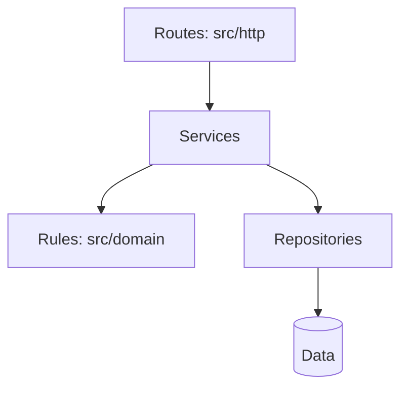
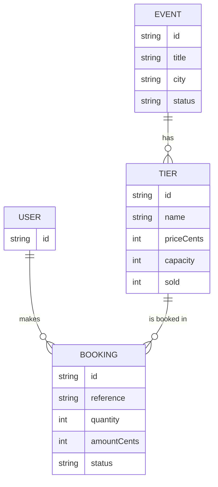
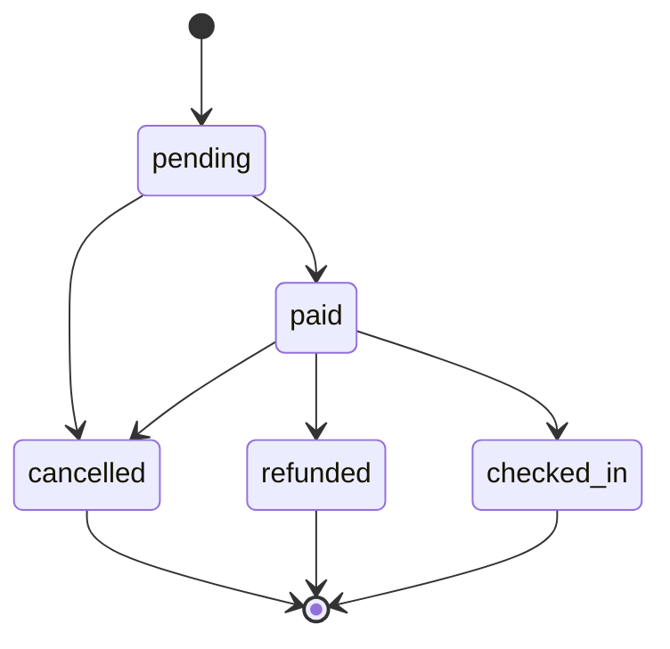

# Architecture

## Layers

- **Routes** read the request and send the response. They may not hold business rules or touch data directly.
- **Services** run one use case by calling rules and repositories. They may not read HTTP requests or build responses.
- **Rules** (src/domain) decide what is allowed, such as capacity and state changes. They may not do input or output, or call upwards.
- **Repositories** save and load data. They may not decide business rules.

Nothing calls upwards. Services and repositories arrive in Build 4. Today the store in `inventory.js` plays that role.

## Data model

## Booking life cycle

